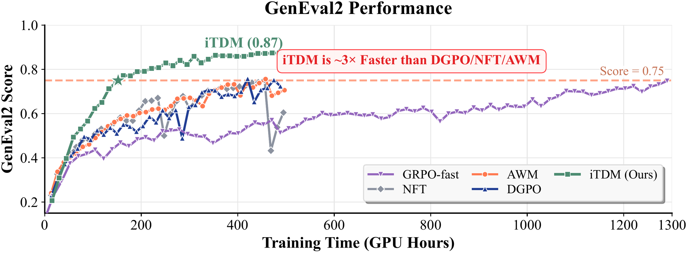
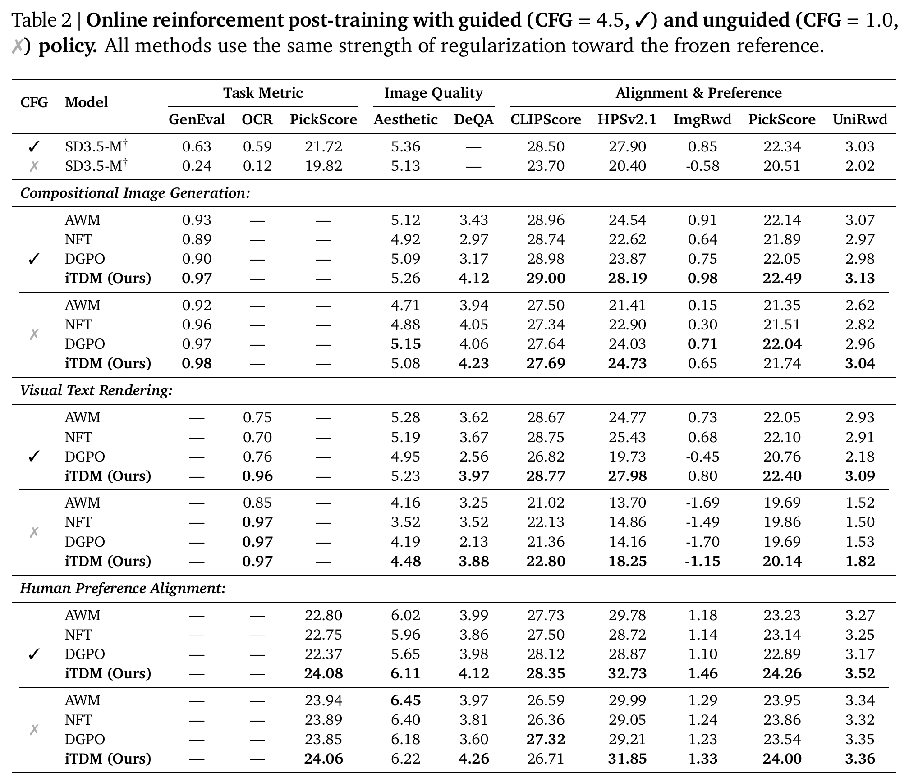
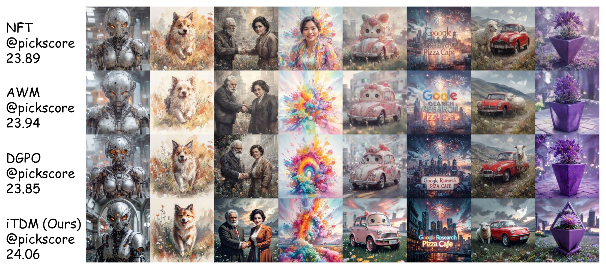

# Reinforcing Diffusion Models by Instantaneous Trajectory Distribution Matching

<p align="center">
  <a href="https://luo-yihong.github.io/iTDM/"></a>&ensp;
  <a href="https://arxiv.org/abs/2611.30986"></a>
</p>

This is the official repository of "[**iTDM: Reinforcing Diffusion Models by Instantaneous Trajectory Distribution Matching**](https://arxiv.org/abs/2611.30986)", by *[Yihong Luo](https://luo-yihong.github.io/)*.

<table align="center">
  <tr>
    <td align="center" width="100%"></td>
  </tr>
  <tr>
    <td align="center"><b>GenEval2 performance on SD3.5-M.</b> iTDM is nearly 3x faster than DGPO, DiffusionNFT, and AWM, while continuously scaling to <b>0.87</b> without training collapse.</td>
  </tr>
</table>

## Table of Contents

- [News](#news)
- [Method](#method)
- [Main Results](#main-results)
- [Quick Start](#quick-start)
  - [Reward Preparation](#reward-preparation)
  - [Start Training](#start-training)
  - [Hyper-parameters](#hyper-parameters)
  - [Checkpoints](#checkpoints)
- [Acknowledgement](#acknowledgement)
- [Contact](#contact)
- [Bibtex](#bibtex)

## News

- (2026/11) [Paper](https://arxiv.org/abs/2611.30986), [Project Page](https://luo-yihong.github.io/iTDM/), and training code are released.

## Method

**Reward-Driven Score Correction & iTDM Gradient.** Forward diffusion RL collects clean rollouts $x_0 \sim q_0$ via deterministic ODE solvers (inducing noisy marginals $q_t$ and marginal velocity $v_q$ along $x_t = (1-t)x_0 + t\epsilon$, $v(x_t \mid x_0) = \epsilon - x_0$) and optimizes the trainable policy velocity $v_\theta$ without trajectory backpropagation. At each noise level $t$, we define the time-local reward-guided target $\pi_t^R(x) \propto q_t(x)\exp(m_t(x))$ with $m_t(x) = \mathbb{E}[R \mid x_t = x]$, whose score differs from the behavior score purely by the **reward-driven score correction** $\nabla_x m_t(x)$:

$$
s_{\pi_t^R}(x) - s_{q_t}(x) = \nabla_x m_t(x).
$$

Applying [Trajectory Distribution Matching (TDM)](https://arxiv.org/abs/2503.06674) to the local transport map $T_\theta(x) = x - \delta v_\theta(x,t)$ and taking the infinitesimal step-size limit $\delta \downarrow 0$ aligns $v_\theta$ directly along this score correction: $`\lim_{\delta\downarrow 0}\nabla_\theta \mathcal{K}_\delta(\theta) = \mathbb{E}_{q_t}[J_\theta^\top \nabla_x m_t(x_t)]`$, where $J_\theta = \partial v_\theta / \partial \theta$. Via the Gaussian posterior-score identity and the tower property in the instantaneous limit, the intractable $\nabla_x m_t$ collapses into an **exact sample-level gradient** anchored at $v_q$—requiring *no* reward-tilted score network. Crucially, for any prompt-level baseline $b(c)$ and centered advantage $A = R - b(c)$, **exact baseline invariance** holds even under *behavior–policy mismatch* ($v_\theta \neq v_q$):

```math
g_t^A := 2\,\mathbb{E}\!\left[A\,J_\theta^\top\big(v_q(x_t,t) - v(x_t \mid x_0)\big)\right] = g_t^R = \frac{2t}{1-t}\,\mathbb{E}_{q_t}\!\left[J_\theta^\top \nabla_x m_t(x_t)\right].
```

**Why Forward Diffusion RL Drifts/Collapse.** Existing forward diffusion RL methods (e.g., DGPO, DiffusionNFT, AWM) instead rely on *signed reward-weighted regression* (RWR) centered at $v_\theta$, $`\mathcal{L}_{\mathrm{RWR}}^A(\theta) = \mathbb{E}\big[A\,\|v(x_t \mid x_0) - v_\theta(x_t,t)\|_2^2\big]`$. Its population gradient decomposes into the iTDM gradient plus **two extraneous drift terms**:

```math
\nabla_\theta \mathcal{L}_{\mathrm{RWR}}^A = \underbrace{g_t^A}_{\text{iTDM gradient}} + \underbrace{2\,\mathbb{E}_{q_t}\!\big[m_t\,J_\theta^\top(v_\theta - v_q)\big]}_{\Delta_t^q:\ \text{drift toward } q_t} - \underbrace{2\,b(c)\,\mathbb{E}_{q_t}\!\big[J_\theta^\top(v_\theta - v_q)\big]}_{\Delta_t^b:\ \text{baseline-induced drift}}.
```

Whenever $v_\theta \neq v_q$—which inevitably arises under CFG-guided rollouts, offline/off-policy updates, and imperfect online self-consistency—signed RWR suffers from two side effects:
1. **Baseline-induced gradient drift ($-\Delta_t^b$)**: subtracting $b(c) > 0$ breaks baseline invariance and pushes $v_\theta$ *away* from $v_q$ during gradient descent, causing unanchored RWR to collapse and anchored variants to stagnate or diverge under CFG-guided and offline RL.
2. **Coarse rollout-artifact fitting ($\Delta_t^q$)**: since $m_t \ge 0$, $\Delta_t^q$ pulls $v_\theta$ toward the coarse few-step ODE behavior marginal $q_t$, fitting discretization artifacts and degrading visual textures and out-of-domain quality even at $\text{CFG} = 1.0$.

By estimating $v_q$ online with a lightweight auxiliary LoRA denoiser $v_\phi$ (plugged in via stop-gradient $`\mathrm{sg}(v_\phi)`$) and regularizing $v_\theta$ toward the frozen reference $v_{\mathrm{ref}}$ rather than $q_t$, **iTDM eliminates both $-\Delta_t^b$ and $\Delta_t^q$** at the auxiliary optimum.

## Main Results

Online RL on SD3.5-M with a CFG-guided policy (CFG = 4.5, ✓) and a conditional policy (CFG = 1.0, ✗). The task metric is GenEval, OCR accuracy, or PickScore, depending on the task. The other seven metrics are **unseen** during training and evaluated on DrawBench.

<p align="center"></p>

<table align="center">
  <tr>
    <td align="center" width="100%"></td>
  </tr>
  <tr>
    <td align="center"><b>Qualitative comparisons on human preference alignment (PickScore) with SD3.5-M.</b> All models are trained and evaluated under CFG = 1.0. iTDM follows intricate prompt details while delivering sharper textures and better aesthetics, avoiding blurry artifacts.</td>
  </tr>
</table>

## Quick Start

Clone this repository and install packages.

```bash
git clone <this-repo-url> iTDM
cd iTDM
conda create -n itdm python=3.10.16
pip install -e .
```

### Reward Preparation

```bash
# GenEval
pip install -U openmim
mim install mmengine
git clone https://github.com/open-mmlab/mmcv.git
cd mmcv; git checkout 1.x
MMCV_WITH_OPS=1 FORCE_CUDA=1 pip install -e . -v
cd ..

git clone https://github.com/open-mmlab/mmdetection.git
cd mmdetection; git checkout 2.x
pip install -e . -v
cd ..

# OCR
pip install paddlepaddle-gpu==2.6.2
pip install paddleocr==2.9.1
pip install python-Levenshtein
```

The GenEval reward loads the Mask2Former detector from `reward_ckpts/mask2former_swin-s-p4-w7-224_lsj_8x2_50e_coco_20220504_001756-743b7d99.pth` (see [flow_grpo/reward_ckpt_path.py](flow_grpo/reward_ckpt_path.py)). Download it from [MMDetection](https://github.com/open-mmlab/mmdetection/tree/2.x/configs/mask2former) and place it there.

### Start Training

All recipes use one node with 8 GPUs.

```bash
# GenEval
bash scripts/single_node/sd3_itdm_geneval.sh
# Visual text rendering (OCR)
bash scripts/single_node/sd3_itdm_ocr.sh
# Human preference (PickScore)
bash scripts/single_node/sd3_itdm_pickscore.sh
```

The recipes default to the **conditional** setting of the paper (`config.sample.guidance_scale = 1.0`). For the **CFG-guided** setting (CFG = 4.5), append `--config.sample.guidance_scale=4.5` to the `accelerate launch` command in the script.

### Hyper-parameters

All recipes are defined in [config/itdm.py](config/itdm.py); defaults that are not set there come from [config/base.py](config/base.py). Any key can be overridden from the command line, e.g. `--config.train.ttur=2`.

| Key | Meaning |
| --- | --- |
| `config.train.learning_rate`, `config.train.adam_beta1`, `config.train.adam_beta2` | Optimizer of the policy LoRA (default lr `3e-4`). |
| `config.train.dsm_learning_rate`, `config.train.dsm_adam_beta1`, `config.train.dsm_adam_beta2` | Optimizer of the DSM LoRA (default lr `3e-4`). |
| `config.train.ttur` | Number of DSM updates per policy update. |
| `config.train.dsm_with_default` | `True`: the DSM forward stacks the frozen policy adapter and the trainable DSM adapter. `False`: DSM is a standalone adapter on the base model. |
| `config.train.beta` | Weight $\beta$ of the velocity-MSE penalty to the frozen base model. 0 disables it. |
| `config.sample.guidance_scale` | CFG used during rollout, evaluation, and the training-time policy and reference forwards; >1 enables CFG. The DSM adapter is always CFG-free. |
| `config.sample.num_image_per_prompt` | Group size $G$. |
| `config.switch_ema_ref` | After this many DSM updates, roll out with a fast EMA of the policy. `-1` never switches (always roll out with the current policy). |
| `config.train.max_policy_steps` | Total policy updates; 0 runs until interrupted. |

Default recipe (excerpt from [config/itdm.py](config/itdm.py)):

```python
config.sample.guidance_scale = 1.0
config.sample.num_image_per_prompt = 24   # 24 groups x 24 images per rollout
config.train.ttur = 1
config.train.dsm_with_default = True
config.train.dsm_adam_beta1 = 0.0
config.train.beta = 1e-3
config.switch_ema_ref = -1
config.train.max_policy_steps = 3000
```

We found that itdm also benefits from hyperparameter-tuning tricks similar to those used in score distillation (e.g., TDM), such as a larger auxiliary DSM learning rate and more auxiliary DSM update steps; these tricks can further improve itdm’s training stability and out-of-domain performance. Feel free to tune it!

## Acknowledgement

Our codebase is built upon [TDM-R1](https://github.com/Luo-Yihong/TDM-R1), [DGPO](https://github.com/Luo-Yihong/DGPO), and [Flow-GRPO](https://github.com/yifan123/flow_grpo). iTDM builds on [Trajectory Distribution Matching (TDM)](https://arxiv.org/abs/2503.06674), and we compare extensively with [AWM](https://arxiv.org/abs/2509.25050) and [DiffusionNFT](https://arxiv.org/abs/2509.16117). We thank the authors for their efforts and open-source code.

## Contact

Please contact Yihong Luo (yluocg@connect.ust.hk) if you have any questions about this work.

## Bibtex

```
@misc{luo2026itdm,
      title={Reinforcing Diffusion Models by Instantaneous Trajectory Distribution Matching}, 
      author={Yihong Luo},
      year={2026},
      eprint={2611.30986},
      archivePrefix={arXiv},
      primaryClass={cs.LG},
      url={https://arxiv.org/abs/2611.30986}, 
}
```
